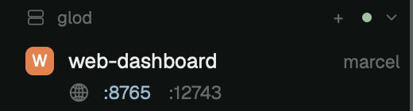

# Herdr Space Ports

A spaces list for the [Herdr](https://herdr.dev) desktop app that shows, under each space, the TCP ports its programs are listening on. Click a port to open it in your browser. If the space runs on another machine, the port is forwarded to this computer over SSH first.



- **Ports under each space.** A port belongs to a space when the process listening on it was started from one of that space's terminals. Ports appear within about 5 seconds and disappear when the server stops.
- **Then the machine's other ports.** After a dot, faded, come the other ports your user is listening on on that machine (below 32768, so ephemeral ports stay out), even if no space started them. They open and forward the same way.
- **Local spaces.** Clicking a port opens `http://localhost:<port>/`.
- **Spaces on other machines.** Clicking a port starts an `ssh -L` forward to the same port on this computer and opens it. If that port is taken here, a free one is used and the label reads `:remote→local`. A forwarded port is shown in the accent color.
- **Stop a forward.** Right-click a forwarded port.
- **Forwards outlive the window.** Each forward is a herdr-core terminal labelled `ports.forward=<machine>:<port>=<local>`, so it keeps running when the app closes or updates, and the mod finds it again on the next start.
- **Everything the spaces list already does.** It's Herdr's own `spaces` mod (0.1.12) with ports added: worktrees under their repo, branch and ahead/behind, a group per machine, colors, and the right-click menu.

## Install

Ask your agent:

```text
Read ~/.config/herdr-app/AGENTS.md, then add this mod: https://github.com/teknologist/herdr-space-ports
It replaces the Spaces sidebar, so point my active layout's spaces block at it.
```

Or by hand: copy `mods/spaces-ports/` into `~/.config/herdr-app/mods/`, then point your layout's spaces block at it.

```sh
git clone https://github.com/teknologist/herdr-space-ports.git
cp -R herdr-space-ports/mods/spaces-ports ~/.config/herdr-app/mods/
herdr-app check ~/.config/herdr-app/mods/spaces-ports
```

### Your layout

Herdr's own layouts are read-only, so if you're on `main`, clone it first. Cloning also switches you to the clone:

```sh
herdr-app do layout.clone '{"name":"main","as":"my-layout"}'
```

Then, in `~/.config/herdr-app/layouts/<your layout>.json`, change the spaces block's mod from `spaces` to `spaces-ports`:

```json
{
  "id": "spaces",
  "type": "block",
  "content": {
    "mod": "spaces-ports"
  }
}
```

Leave the block's other keys (`size`, `min`, and so on) as they are.

To go back, set it to `"spaces"` again.

### Update

`git pull` doesn't change the installed copy. Copy `mods/spaces-ports/` into `mods/` again.

This is a copy of Herdr's `spaces` mod, so it doesn't pick up Herdr's later changes to it. [RECIPE.md](RECIPE.md) lists the edits, so an agent can redo them on a fresh clone of `spaces`.

## How it works

Every 5 seconds, the mod runs one `sh` on each machine that has a space with a live terminal. That command lists the listening sockets with their process ids (`ss -ltnp` on Linux, `lsof` on macOS) and the parent of every process. The mod then walks each listener's parents up to a space terminal's shell.

To forward a port, it runs this as a herdr-core terminal:

```sh
ssh -N -o ControlMaster=no -o ControlPath=none -o ExitOnForwardFailure=yes \
    -o ServerAliveInterval=15 -L 127.0.0.1:<local>:localhost:<port> <target>
```

`<target>` is the machine's target from `hc machine ls`. `ControlMaster=no` keeps the forward in that terminal even when your `~/.ssh/config` shares connections. Without it, ssh hands the listener to a background master, and the forward can't be found or stopped.

## Limits

- A server that detaches from its terminal (for example a daemon re-parented to pid 1) doesn't show.
- Only TCP ports are listed, and only ports whose process the user can see.
- Forwards bind `127.0.0.1` on this computer only.

## What it touches

- It runs `sh`, `ss` or `lsof`, `ps` and `awk` on each machine with a space, every 5 seconds.
- On click, it runs `ssh`, `lsof` and `open` on this computer, plus `hc run`, `hc get` and `hc kill`.
- Like the shipped `spaces` mod it is built from, it watches each space's repo folder and runs `git` there for the branch line.
- It makes no network requests of its own, apart from the `ssh` forwards you start.

## License

[Apache-2.0](LICENSE). The mod is a modified copy of Herdr's `spaces` mod, which is under the same licence. The notice at the top of `mods/spaces-ports/main.js` lists the changes.
