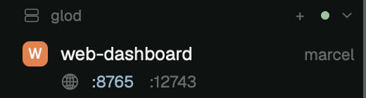

# Space Ports

The Spaces sidebar, plus one line under each space listing the TCP ports that
space's programs are listening on, like the old herdr-gpui status line. Click a
port to open it in the browser: on this computer it opens `localhost:<port>`,
on another machine it first starts an `ssh -L` forward to this computer.

## What you see

- The shipped Spaces list, unchanged, except that a space with listening ports
  is 18px taller.
- Under its name row: a globe (`U+1F310` text form), then `:<port>` for each
  port in ascending order, 11.5px, `theme().dim`, 6px apart, indented 27px
  (22px for a worktree row) so it lines up with the name.
- A port forwarded right now is drawn in `theme().accent`. If it was forwarded
  to a different local port (the same number was taken here), it reads
  `:<remote>→<local>`.

## How it behaves

- Every 5 s, for each machine that has a space with a live terminal, one `sh`
  runs there (through `exec(..., { on: machine })`). It lists listening
  sockets with their pids (`ss -ltnpH` on Linux, `lsof -iTCP -sTCP:LISTEN` on
  macOS) and the `pid ppid` table. A port belongs to a space when its process
  descends from one of that space's terminals' shell pid (label
  `herdr.space`). The row redraws only when the set changes.
- Hover a port: a tooltip says what a click does (`Open localhost:N`,
  `Forward glod:N and open`, or `Forwarded to localhost:M`).
- Click a local space's port: `open http://localhost:<port>/`.
- Click a remote space's port: if a forward for it is live, open its local
  port. Otherwise pick a local port (the same number if free, else a random
  one from 20000–59999), start
  `hc run --bg --no-parent --no-notify --rm --label ports.forward=<machine>:<port>=<local> -- ssh -N -o ControlMaster=no -o ControlPath=none -o ExitOnForwardFailure=yes -o ServerAliveInterval=15 -L 127.0.0.1:<local>:localhost:<port> <target>`,
  wait (up to ~10 s) for it to listen, show a notification, and open it.
  `<target>` is the machine's `target` from `hc machine ls --json`.
- Right-click a forwarded port: `hc kill` its ssh terminal, which ends the
  forward.
- Forwards are herdr-core terminals, so they survive closing the window. They
  are found again by their `ports.forward` label.
- Clicking a port does not select the space (the event stops at the port).

## Built from

- A clone of the shipped `spaces` mod (`mod.clone {name: "spaces", as:
  "spaces-ports"}`). The layout's `spaces` block points at
  `{ "mod": "spaces-ports" }`.
- `ports.js`: `PortScanner` (`scan()` → `bySpace: { [spaceId]: number[] }`),
  `forwards()`, `openPort(machine, port, target)`, `stopForward(machine, port)`.
  Uses `terminals`, `exec`, `hc`, `notify` from `herdr`.
- `main.js` edits to the clone: import `ports.js`; in `init`, create the
  scanner and scan every 5000 ms with `cx.timer.every` (not once from init); in `row()`, add
  18px when there are ports and append `portsLine(w, tree, t)`; add
  `portList(w)`, `otherPorts(w)`, `hasPorts(w)` and `portsLine(...)`.
- Other ports: every listener the scan saw on a machine that no space owns,
  below 32768, whose process or an ancestor has a tty (`ps -o tty=` not
  `?`/`??`), minus the local ends of this mod's forwards, goes to
  `byMachine[machine ?? ""]`. `portsLine` draws the space's own ports, then
  a `·`, then those at opacity 0.6; they click like the others.
- Space ids: a local space is its `herdr.space` label. A remote one is
  `<machine>/<label>`, and its terminal addresses look like `<machine>/t3`.
- The shell pid comes from `terminals()[i].pid`, or `hc get <address> --json`
  when it is missing.
- Programs run: `sh`, `ss` or `lsof`, `ps`, `awk`, `ssh`, `open`, `sleep`.

## Watch out

- It runs programs: one `sh` per machine every 5 s, plus `ssh` on click.
- Don't scan from `init`. When the layout switches a block to this mod, an
  `exec` started while the new copy is being created never answers; a
  "scan running" flag then blocks every later scan and no ports ever show.
  Start scanning from `cx.timer.every(5000, ...)` only, and treat a scan
  older than 20 s as dead.
- `ControlMaster=no` / `ControlPath=none` are required when `~/.ssh/config`
  multiplexes. Without them ssh hands the listener to a detached master, the
  terminal ends at once, and the forward can't be found or stopped.
- Ports opened by a program that daemonizes (re-parents to pid 1) don't show:
  they are no longer under a terminal.
- On Linux, `ss -p` shows pids only for your own processes. That is all this
  needs.
- This is a clone of Herdr's `spaces` mod at 0.1.12. After a Herdr update,
  re-clone `spaces` and re-apply the `main.js` edits above, keeping
  `ports.js`.
- `herdr-app check` renders headless without live data, so it can't show the
  ports line. Check it in the window (`herdr-app shot`).

## Done when

- `herdr-app check mods/spaces-ports` passes.
- Running `python3 -m http.server 8765 --bind 127.0.0.1` in a remote space's
  terminal makes `:8765` appear under that space within ~5 s, and stopping it
  makes it go away.
- Clicking `:8765` opens the page here. `curl localhost:8765` answers 200 and
  `hc ls` shows a live `ssh` terminal with label `ports.forward=<machine>:8765=8765`.
- The port turns accent-colored. Right-clicking it ends the ssh terminal and
  the color returns to dim.
- A local space's port opens `localhost:<port>` without starting ssh.
